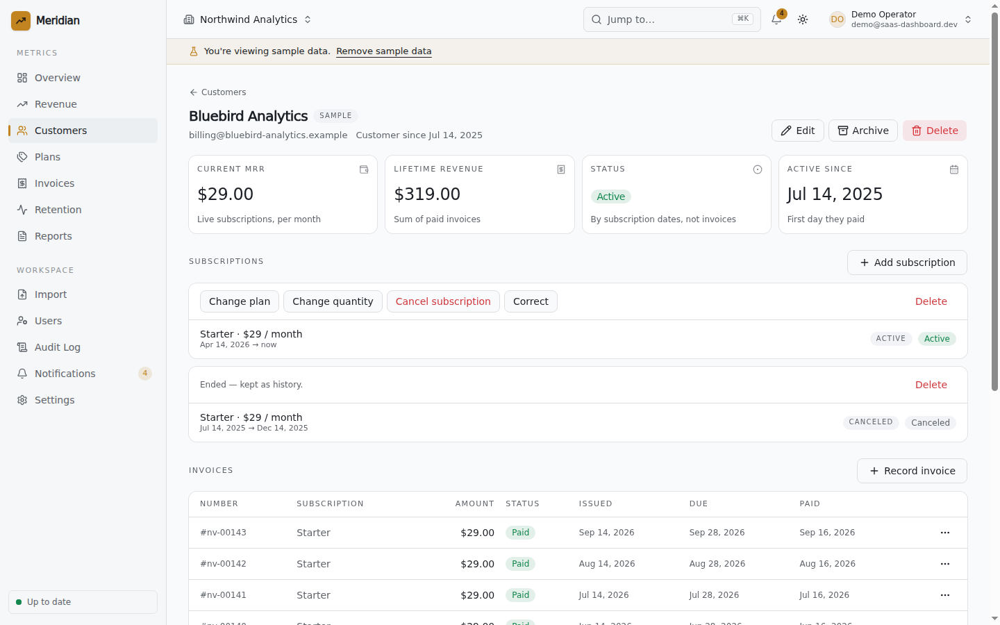
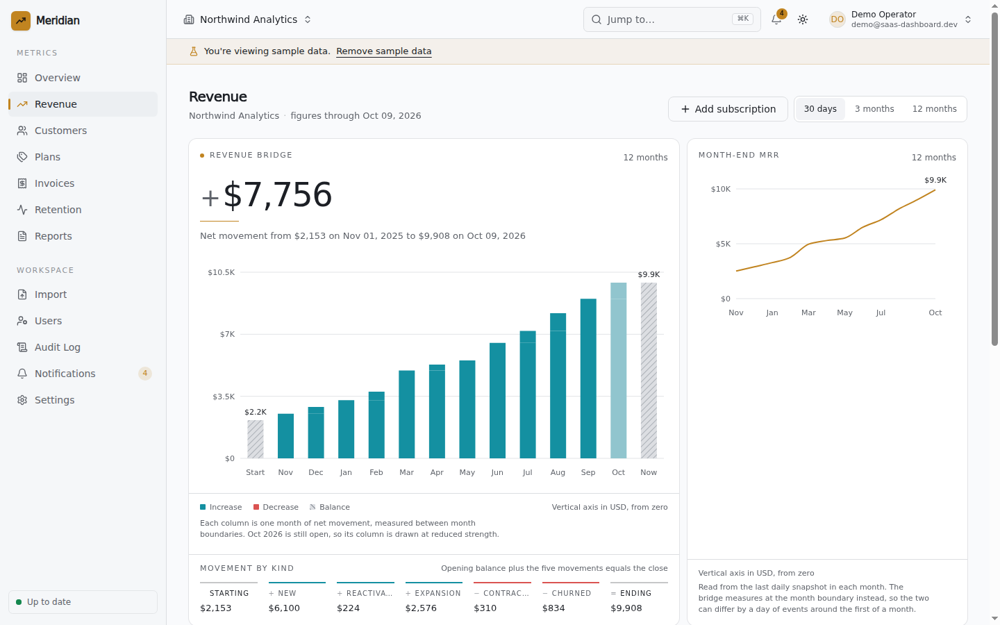
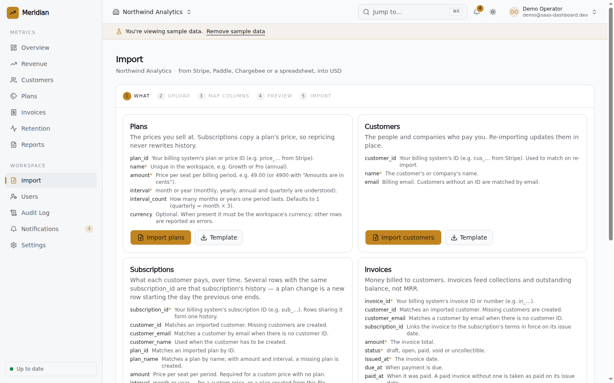
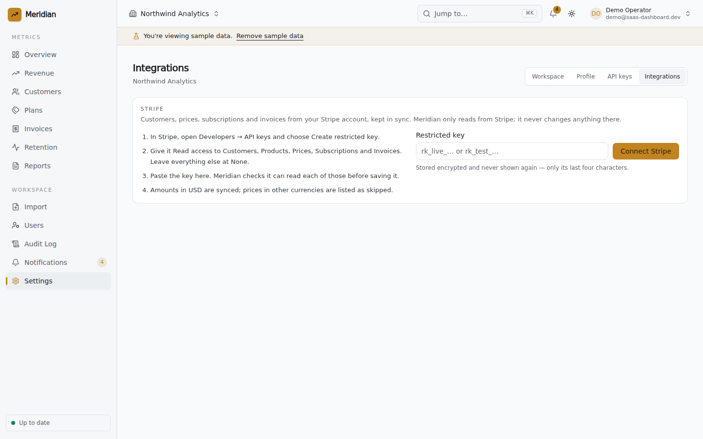

# Meridian

**SaaS revenue metrics you can reconcile to the cent.** Meridian turns a company's billing data into MRR, ARR, churn, net and gross revenue retention, and the revenue bridge — and shows exactly which customers moved the number.

Founders bring their data three ways: **import a CSV** (Stripe, Paddle, Chargebee or a spreadsheet), **push it from their backend** over a REST API, or **connect Stripe** and let it sync. Everything can also be entered and corrected by hand.

**[Live demo →](https://saas-dashboard-tan-two.vercel.app)** Click **Try the demo** to open a workspace of sample data, no sign-up needed. You can also register and bring your own data. The demo is rebuilt every night.


| | |
|---|---|
|  |  |
|  |  |

## What it does

- **Metrics:** MRR and ARR (yearly and quarterly plans normalized), the revenue bridge (new, expansion, contraction, churn, reactivation), NRR and GRR, customer and revenue churn as two separate rates, cohorts and plan mix, with daily history.
- **Billing data:** customers, plans and subscriptions, with the full lifecycle (backdated starts, plan and quantity changes, scheduled and past cancellations, corrections) and invoices. Every change recomputes the past days it touches.
- **Ways in:**
  - CSV import with column mapping, a dry-run preview, idempotent re-imports and an error report.
  - REST API v1 with scoped, hashed keys, Postgres-backed rate limits and an OpenAPI document (`/docs/api`).
  - Stripe sync with a read-only restricted key (encrypted at rest), signed webhooks for live updates, and a nightly safety-net sync.
- **For teams:**
  - Workspaces, each in its own currency.
  - Owner / admin / member roles, enforced on the server.
  - Invites by email, an audit log, suspension.
  - Alerts: a large customer churning, MRR dipping, overdue invoices, MRR milestones.
  - A Monday summary, per-person notification preferences, and reports emailed on a schedule.
- **Accounts:** email and password with confirmation, password reset (which signs out every other session), optional GitHub sign-in, and a public demo that is rebuilt every night.

## Stack

Next.js 16 (App Router, Server Components, Server Actions) · TypeScript (strict) · Tailwind CSS 4 + shadcn/ui · Prisma 7 on PostgreSQL · NextAuth · Recharts · Zod.

No SDKs for Stripe or email: both are plain `fetch` against their HTTP APIs.

## Architecture in brief

```
app/                    routes: (auth) pages, (dashboard) pages, api/ (REST v1, cron, webhooks)
lib/
  metrics.ts            every metric, in SQL, from Subscription rows — one definition each
  snapshot-formula.ts   the daily snapshot math, shared by recompute, sample data and tests
  snapshots.ts          per-workspace recompute from the earliest day a write touched
  billing-ops.ts        the billing rules (create / change / cancel / correct …)
  api/resources/*       the REST API's resources — and the Stripe sync, which reuses them
  import/*  csv/*       CSV parsing (RFC 4180, delimiters, BOM) and the import engine
  stripe/*              read-only Stripe client, sync, webhook verification
  alerts.ts             churn / dip / overdue / milestone alerts, each said once
  mail.ts               one sendMail(): Resend, or a local mailbox for dev and tests
prisma/                 schema and hand-reviewed migrations
scripts/                verification suite, end-to-end suites, fake Stripe, screenshots
```

Decisions worth reading the code for:

- **Money is integer minor units, everywhere.** Each workspace reports in one currency, and amounts are rounded once, at the end of a sum. That way SQL and JavaScript agree on the last cent; the verification suite tests the 24¢-vs-25¢ case.
- **A subscription is a chain of segments.** A plan change ends one segment and starts the next the same day, linked to it. History is never rewritten except by an explicit "Correct".
- **One set of billing rules.** The UI's Server Actions, the REST API, the CSV importer and the Stripe sync all write through the same operations. A Stripe subscription behaves exactly like one entered by hand.
- **Tenancy is checked in every query.** Each action re-verifies the caller's membership by composite key, and every record id from the client is re-scoped to the workspace inside the query itself.
- **Secrets:**
  - Passwords are hashed with scrypt.
  - Invite, reset and confirmation tokens and API keys are stored only as SHA-256 hashes.
  - Stripe keys and webhook secrets are encrypted with AES-256-GCM, because the app has to read them back.
  - Webhooks are verified with HMAC and a replay window.
- **Safe by default in production:** a strict Content Security Policy and security headers, structured error logs (`instrumentation.ts`), Core Web Vitals reporting, and a `/api/health` endpoint. The seed refuses to run in production.

## Run it locally

Requirements: Node 22, PostgreSQL 16.

```bash
cp .env.example .env          # set DATABASE_URL and NEXTAUTH_SECRET (openssl rand -base64 32)
npm ci                        # also generates the Prisma client
npx prisma migrate deploy
npx prisma db seed            # demo user, two workspaces of sample data
npm run dev
```

Sign in with `DEMO_EMAIL` / `DEMO_PASSWORD` from your `.env`, or register a new account. Without an email provider, emails are written to a local folder and logged, and the confirmation and reset links work from there.

## Tests

| Command | What it checks |
|---|---|
| `npm run typecheck`, `npm run lint` | TypeScript strict, ESLint |
| `npm run verify:metrics` | ~400 checks against the database: every metric against hand-computed fixtures, billing lifecycle, CSV parsing and import, the REST API, email tokens, alerts and schedules, Stripe sync against a fake Stripe, the demo reset |
| `npm run e2e:*` | Headless Chrome through the real UI against `next start`: onboarding, billing, import, api, email, notifications, stripe, production |

CI (GitHub Actions) runs all of it on every pull request against a fresh Postgres. It starts by checking that the migrations and `schema.prisma` agree.

The e2e suites need the fake Stripe running (`npm run fake:stripe`) and the app started with `STRIPE_API_BASE=http://127.0.0.1:12111` and `MAIL_DEV_DIR` set. See `.github/workflows/ci.yml`.

## Deploy

See [docs/DEPLOY.md](docs/DEPLOY.md) for Vercel with a hosted Postgres, including environment variables, the daily cron, email and the public demo.

## Roadmap

[docs/ROADMAP.md](docs/ROADMAP.md) lists what is done, what's next, and known limits.

## License

[MIT](LICENSE) © 2026 Parsa Motlagh
